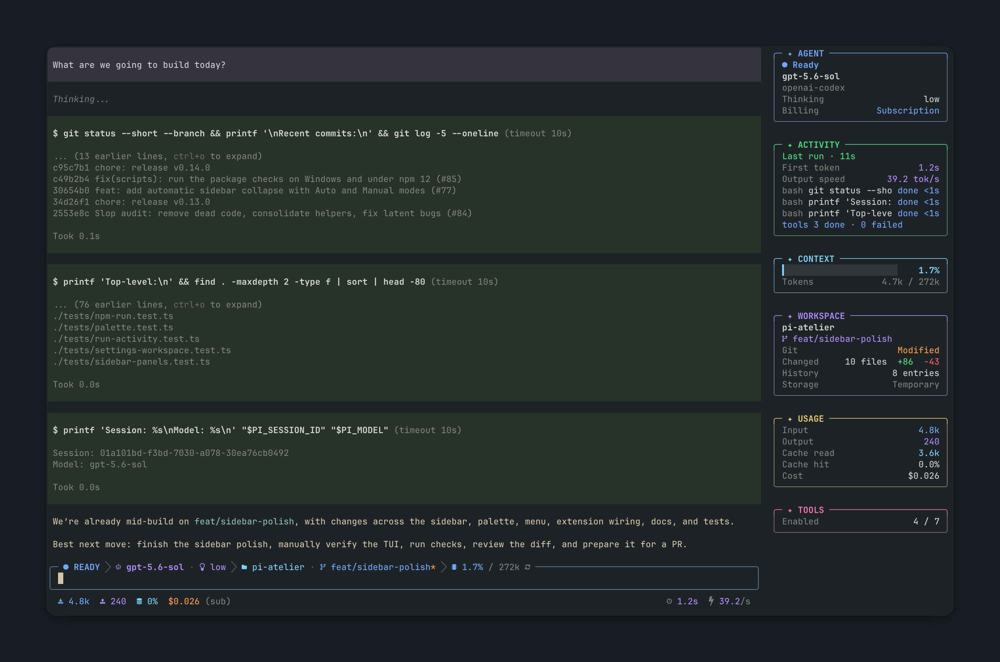

<div align="center">

# Pi Atelier

**A responsive status rail and live activity sidebar for [Pi](https://pi.dev).**

Keep model, context, Git status, usage, and tool activity in view while you work.

[](https://www.npmjs.com/package/pi-atelier)
[](https://www.npmjs.com/package/pi-atelier)
[](#requirements)
[](#requirements)
[](#privacy)
[](https://github.com/michaelmjhhhh/pi-atelier/blob/main/LICENSE)

[Quick start](#quick-start) · [Features](#features) · [Usage](#usage) · [Configuration](#configuration) · [Troubleshooting](#troubleshooting) · [Privacy](#privacy)

[](https://github.com/michaelmjhhhh/pi-atelier/releases/download/v0.10.0/demo.mp4)

<sub>▶ <a href="https://github.com/michaelmjhhhh/pi-atelier/releases/download/v0.10.0/demo.mp4">Watch the demo (v0.10.0)</a></sub>

</div>

## Quick start

```bash
pi install npm:pi-atelier
```

Start Pi and open the control center with `/atelier` or **F6** (**Fn+F6** on keyboards with media keys).

> [!TIP]
> Atelier starts in Plain text mode, which works with any monospace font. For icons, select a Nerd Font in your terminal and choose **Settings → General → Font → Nerd Font**. See [Terminal font](#terminal-font).

> [!NOTE]
> Atelier uses the core packages of the running Pi host. Its npm peers are optional so installing it never pulls in a second copy of Pi; update Pi itself separately. Pi packages run with your system permissions, so review third-party source before installing.

### Requirements

| | |
| --- | --- |
| Pi | 0.84.0 or newer |
| Node.js | 22.19.0 or newer |
| Mode | Interactive TUI |
| Font | Any monospace font (Plain text mode) or a Nerd Font (icons) |

### Terminal font

Plain text mode is the default. It works with any monospace font and keeps colors, metrics, and the responsive layout. Nerd Font mode adds icons to the footer and the Sidebar (one per panel title, plus tool, todo, and alert marks) but needs a terminal font that covers them, such as one from [nerdfonts.com](https://www.nerdfonts.com) or a Symbols Nerd Font Mono fallback; without one, the icons render as boxes. Switch in **Settings → General → Font** or set `"nerdFont": true`.

## Features

| | |
| --- | --- |
| **Session visibility** | Model, thinking level, context, token usage, and cost in a compact status rail, with optional sidebar panels for the same details. |
| **Live activity** | Agent and tool activity, TODOs, response timing, and completion notifications on macOS and Windows. |
| **Session panel** | An opt-in **Session** panel with the session's goal and where it stopped, written by a model after each run, so a session you switch back to says what it was for. |
| **Workspace context** | The files you have changed, with lines added and removed per file, from read-only Git status. |
| **Subagent costs** | Colored per-child cost curves from pi-subagents accounting events, with matching legends and real observation markers. `/atelier usage` opens a larger framed graph with keyboard focus and per-reply costs. Kitty-compatible terminals get native graphics; others get text strokes. |
| **Prefill progress** | While a local model is still reading a long prompt, a temporary sidebar panel shows how far through the prompt it is, how fast it is reading, and how long until the first token. |
| **Personalization** | Display presets, configurable segments and panels, optional Nerd Font icons, and model and tool controls. |
| **Extensible sidebar** | Other extensions can add their own panels. See [Sidebar panels from other extensions](#sidebar-panels-from-other-extensions). |

No telemetry. No network requests of its own, except the Session panel's recaps, which go through Pi's configured providers. See [Privacy](#privacy).

## Usage

Open `/atelier` or press **F6** to change display settings, control the sidebar, select models and tools, or view subagent usage.

```text
/atelier settings [page]      settings; page is general, rail, sidebar, or recap
/atelier display              settings, on the Status rail page
/atelier goal <text>          set the session goal; no text clears it
/atelier goal auto            write the goal again after the next run
/atelier usage                subagent cost graph
/atelier sidebar              toggle sidebar visibility
/atelier sidebar auto|manual  choose sidebar mode
/atelier sidebar on|off       show or hide without changing mode
/atelier sidebar tools        toggle tool names
/atelier enable|disable       set extension state
```

### Sidebar

| Mode | Behavior |
| --- | --- |
| **Manual** (default) | Resize with `Ctrl+Shift+R` (or your `resizeShortcut`), then the arrow keys or by dragging the divider. Enter or mouse release confirms; Escape cancels. Hides below 92 columns and returns at 92. |
| **Auto** | Collapses when space is tight and reopens when there is room. At the default width it collapses below 124 columns and reopens at 132. Manual resizing is disabled. |

- Showing or hiding is independent of the mode. A manually hidden sidebar stays hidden when the terminal grows.
- The preferred width survives terminal resizes and mode changes.
- A confirmed resize is saved as `sidebarWidth` and becomes the starting width for new sessions. Escape keeps the saved width.
- Mode and visibility are session-scoped. The startup visibility preference is set in **Settings → Sidebar → Show at startup**.
- The sidebar shows what the footer cannot: whether the agent is working and which tools are running or just finished, your TODOs, the context meter, and the files you changed with lines added and removed. Model, usage, and tool counts are already in the footer, so the Agent, Usage, and Tools panels start hidden; turn them on in **Settings → Sidebar**. Activity also lists the first-token time and output speed of the latest response, which the footer shows only when its `performance` segment is on. A layout you saved earlier keeps its own choices.
- While nothing is running or recently finished, the Activity panel reserves its tool row with a dim `—`, so the panel keeps a constant height between turns instead of the row appearing and disappearing and shifting the panels below it. On a short terminal the placeholder is the first Activity row to go.
- Every panel has the same neutral grey frame; its title and ✦ (in Nerd Font mode, the panel's icon) keep a color of their own. A frame lights up only when its panel needs attention: Activity while the agent works (red on an error), Context past your warning and danger thresholds, Changed files on a merge conflict. Inside the panels, color marks state only. When a run finishes, the Activity frame glows green for three seconds, then returns to grey.
- **Settings → Sidebar → Style** switches between **Framed** (the default) and **Minimal**: no frames, just quiet headings that take the state color instead. The setting is saved as the user-only `sidebarStyle` (`"framed"` or `"minimal"`).
- The TODO panel supports Pi `todo` results and the optional `@juicesharp/rpiv-todo` extension. Atelier does not change `todo` results, so the agent keeps task ids and `list` output.

### Session panel

The **Session** panel answers "what was this for, and where did it stop?" when you switch back to
a session. It is off by default; turn it on in **Settings → Sidebar**. It sits at the top of the
Sidebar, with the time since the last run on its frame, or `updating…` while a recap is written.

```text
╭─ ✦ Session ──────────────────── 6m ago ╮
│ Python tasks CLI with tasks.json       │  goal: bright, bold
│ › todo.py verified; awaiting commit    │  status: secondary grey
│   decision                             │
│                                        │
│ deepseek-flash                 $0.0002 │  recap model and cost: dim
╰────────────────────────────────────────╯
```

The goal is the panel's headline (up to two lines); the status follows a `›` in the panel's color
(up to three lines), or the TODO's own mark while a TODO is in progress. On a narrow Sidebar the
model name gives way to `recap` so the cost stays readable; on a short terminal the recap row and the
blank line above it go first, then the status.

While the panel is shown, a model writes its two lines after each run that ends with a reply:

- **Goal** is written once: a 3-8 word title of the subject and outcome, following the rules T3
  Code uses for thread titles. If the subject is still unknown after a run (a greeting, "fix
  this", a pasted path), the goal waits for the next run. `/atelier goal <text>` sets your own;
  `/atelier goal` alone clears it; `/atelier goal auto` has the goal written again after the next
  run, keeping the old one if it is still accurate.
- **Status** is rewritten after every run: where the work stands or the next step.
- A dim row names the model (without its provider or date stamp) and the cost of the recap behind
  the lines shown, marked `(sub)` like the footer when a subscription pays for it. Pi's own usage
  totals do not include recaps.

| Row | Source, first match wins |
| --- | --- |
| **Goal** | `/atelier goal <text>`; the generated goal; the session name made readable (`issue-42-43` → `issue 42 43`; generated names such as `subagent-…-<uuid>` are hidden). Otherwise a hint. |
| **Status** | The TODO in progress; the latest recap, until a newer reply arrives; the first sentence of the last reply that says something (headings, code, and replies like "Done." are skipped). |

- The goal and recaps are stored in the session as custom entries, so they survive `/resume` and
  follow `/tree` branches. They are never sent to the model.
- The panel refreshes when a run ends and when a session starts, resumes, or changes branch;
  never mid-run, except that the TODO in progress shows as soon as it changes.
- A recap runs in the background after the run settles and is cancelled if you start a new run.
  A missing model, missing authentication, a failed reply, or a reply that calls a tool or misses
  the format warns once per session and leaves the panel on its other sources.

**Which model writes it** (**Settings → Session recap → Recap model**, `sessionRecapModel`, user-only):

- **Session model** (default, `""`): the conversation is replayed as the agent sends it, plus one
  recap request, right after the run while the provider's prompt cache is warm. The prefix is read
  from the cache, so a recap of a 50k-token session costs about $0.007 on Claude Sonnet 5.5 or
  $0.012 on GPT-5.6 terra, plus any thinking tokens: the recap keeps the session's thinking level,
  because changing it would miss the cache. The transcript goes nowhere it has not already gone.
  Needs Pi 1.6 or newer. Codex sessions, Pi's `blockImages` setting, and older Pi versions use an
  excerpt instead, since a replay there would not match what the agent sent. If a replay misses
  the cache, for example because another extension changes what the agent sends, Atelier warns
  once with the cost.
- **Another model** (`"provider/model"`): sends an excerpt of up to 12,000 characters (your first
  request and the latest messages, without tool output; long messages keep their start and end) to
  that model, uncached and without reasoning. A small model
  costs about $0.001 per recap. This can send the transcript to a different provider.

Turn **Settings → Session recap → Session recap** off (`"sessionRecap": false`, user-only) to keep the panel
without model requests: the goal then comes from `/atelier goal` or the session name, and the
status from the last reply.

### Prefill progress

A long prompt against a local model looks exactly like a hang. When a request streams to an
allow-listed provider, Pi Atelier asks it for prefill progress and shows a temporary **Prefill**
panel between Context and Workspace: a bar over the uncached prompt tokens, the token counts, the
reading speed, and an estimate of how long until the first token.

- Present only while prefilling: it appears above 1024 uncached tokens or 300ms of reading, and is
  dropped when generation starts, so it reserves nothing when it is absent. Hide the sidebar and
  there is no prefill UI.
- Only `openai-completions` endpoints are asked. Servers ignore request fields they do not know,
  so a provider that cannot report progress never draws the panel, and no request error turns it
  off for the rest of the session.
- The field is added only when the request body names the allow-listed model, so a Pi virtual
  model or a redirected request is left alone.
- An allow-list entry is a provider id: `llama.cpp` for Pi's built-in llama extension, or the
  llama-swap instance id for pi-llama-swap. A proxy forwards the field to whatever server runs
  behind it, so progress appears only when that upstream reports it.
- Percent counts **uncached** tokens, so a prompt already in the cache shows little or nothing.
- Speed is measured between progress chunks, and the first sample counts only uncached tokens, so a
  warm prompt does not report a false speed.

```json
{
  "prefillEnabled": true,
  "prefillViews": ["percent", "tokens", "eta", "rate"],
  "prefillProviders": ["llama.cpp"]
}
```

`prefillViews` accepts `percent`, `tokens`, `eta`, and `rate`. `prefillProviders` is user-only and
read at session start; `[]` asks no provider. Each entry must equal the provider id of the model you
run, so the default `llama.cpp` covers only Pi's built-in llama extension: a pi-llama-swap model uses
its instance id, such as `llama-swap-tre`. Matching ignores case and surrounding spaces. Progress
reporting needs Pi 0.99 or newer.

### Status rail presets

| Preset | Layout |
| --- | --- |
| **editorial** | Default layout |
| **minimal** | Compact layout |
| **classic** | Detailed telemetry |

Pi supports one custom footer and one custom editor at a time. Extension load order decides which one is visible. To keep another extension's footer and use only the Atelier sidebar, choose **Settings → General → Atelier footer → Off** (it takes effect when Settings closes) or set `"showFooter": false`. This also leaves Pi's composer unchanged. The sidebar does not show extension statuses while the Atelier footer is off.

## Configuration

| Scope | Path |
| --- | --- |
| User | `~/.pi/agent/pi-atelier.json` |
| Project (trusted only) | `<project>/.pi/pi-atelier.json` |

Project settings override user settings, and session changes override both. Font mode, footer, sidebar startup, sidebar width, sidebar style, notification preferences, the prefill provider allow-list, and the session recap settings are user-only.

```json
{
  "preset": "editorial",
  "nerdFont": false,
  "shortcut": "f6",
  "resizeShortcut": "ctrl+shift+r",
  "toggleShortcut": "",
  "density": "comfortable",
  "hiddenFooterFields": [],
  "contextWarning": 70,
  "contextDanger": 90,
  "showFooter": true,
  "showSidebarOnStartup": true,
  "sidebarWidth": 44,
  "sidebarStyle": "framed",
  "showSidebarToolNames": false,
  "completionNotifications": true,
  "prefillEnabled": true,
  "prefillViews": ["percent", "tokens", "eta", "rate"],
  "prefillProviders": ["llama.cpp"],
  "sessionRecap": true,
  "sessionRecapModel": ""
}
```

`resizeShortcut` is the Sidebar resize key, `ctrl+shift+r` by default. A custom key replaces the default, so `ctrl+shift+r` stays free for other extensions. A blank value or a key that matches `f6` or `shortcut` warns and falls back to `ctrl+shift+r`. Set a key such as `"alt+r"` and run `/reload`.

`toggleShortcut` binds a key that shows or hides the Sidebar directly, like `/atelier sidebar`. It is empty (no binding) by default; set a key such as `"ctrl+shift+b"` and run `/reload`. A key that matches `f6`, `shortcut`, or `resizeShortcut` is rejected with a warning.

`hiddenFooterFields` hides single readings inside status rail segments and keeps them hidden when you switch presets:

| Segment | Fields |
| --- | --- |
| Tokens & cost | `input`, `output`, `cache`, `cost` |
| Speed | `ttft`, `tps` |
| Context | `contextWindow`, `autoCompact` |
| Model | `model`, `thinking` |
| Git | `workspace`, `branch` |

`sidebarWidth` is the sidebar width in columns when a session starts, from 28 through 72. The sidebar still narrows when the terminal leaves less than 64 columns for the main pane.

**Settings** (`/atelier settings`, or **Settings** in the Control Center) has four pages: **General** (font, Atelier footer, notifications), **Status rail**, **Sidebar** (style, startup, tool list, prefill progress, panels), and **Session recap**. Tab and Shift+Tab switch pages; each page keeps its selection. A wide terminal lists the pages on the left, and a narrow one shows them as tabs. A dot marks a page with unsaved changes, and a note at the top of each page says how its changes are kept.

On **Status rail**, reorder or hide segments. The **Pi** segment shows a single `π` at the start of the rail and takes less room than **Brand**. Every segment can be hidden; → opens a shown segment's fields so you can hide single readings, such as cost or the thinking level, and ← closes them. A live preview of the status rail stays pinned at the top. Press Enter to show or hide the selected item, Shift+↑/↓ to move it, ←/→ to change the preset or density, and `s` to save as your default. Status rail changes apply to the session at once; sidebar panel changes apply when you save, and Escape asks once before closing without them. The other settings save as you change them. Undo (`u`) restores the latest change on the page in view, including a Revert (`r`). The legacy user settings `showSidebarAgent` and `showSidebarTodos` still apply when `sidebarPanelLayout` is absent. A layout you saved before Prefill existed gains that panel next to Context on the next start; one saved before Session gains it hidden.

### Sidebar panels from other extensions

Another extension can add a panel through Pi's event bus. `registerSidebarPanel` publishes the panel and answers discovery requests, so either extension may load first:

```ts
import { registerSidebarPanel } from "pi-atelier/extensions/index.ts";

const panel = registerSidebarPanel(pi, {
	id: "vendor:queue",
	title: "Queue",
	rows: ["2 queued", { text: "1 failed", role: "error" }],
});
panel.update({ id: "vendor:queue", title: "Queue", rows: ["idle"] });
panel.dispose();
```

For responsive label/value columns like the built-in Usage panel, supply optional
`keyValues` alongside the mandatory plain-text `rows` fallback:

```ts
registerSidebarPanel(pi, {
	id: "vendor:limits",
	title: "Subscription",
	rows: ["Used 32.2%", "Time 50.0%"],
	keyValues: [
		{ label: "Used", value: "32.2%", progress: 0.322, valueRole: "success" },
		{ label: "Time", value: "50.0%", valueRole: "muted" },
	],
});
```

Atelier places labels on the left and values on the right at the current panel
width, recalculating on resize and truncating long fields like its built-in rows.
Labels default to `muted`; values default to the panel role or `primary`.
`labelRole` and `valueRole` accept the same semantic roles as plain rows,
including `success` (green), `caution` (yellow), `warning` (orange), and `error` (red).
A valid, nonempty `keyValues` list replaces the fallback rows on supporting hosts.
Empty, malformed or oversized lists fall back to `rows`; older Atelier versions
ignore the optional representation. The existing row count and text size limits
apply to both fields. This is a two-column presentation, not a general table.

Optional `progress` adds a bar between the label and value, using the value role.
It is a finite fraction from `0` (empty) to `1` (full), inclusive. Invalid fractions
are ignored without dropping the row. Producers should cap over-limit fractions at
`1` while retaining accurate value text such as `110%`. The bar disappears when
fewer than four bar columns fit; label/value rendering is retained. Older hosts
ignore `progress`. No-color mode uses plain filled/empty blocks.

- Panel IDs are namespaced (`vendor:name`).
- New panels start hidden; enable them in **Settings → Sidebar**.
- Titles and rows are plain text. Terminal sequences are stripped and oversized payloads are rejected (see the exported `SIDEBAR_PANEL_MAX_*` limits).
- Extensions that cannot import the helper can emit the exported `SidebarPanelEvent` types on the `pi-atelier:sidebar-panels` channel directly.

## Troubleshooting

| Problem | Fix |
| --- | --- |
| Shortcut does nothing | Use `/atelier`, change `shortcut`, then run `/reload`. The default is `f6` on macOS and Windows; media-key keyboards may need Fn+F6. Saved `alt+a` settings resolve to `f6` and Alt+A is no longer registered. Other custom shortcuts add a binding alongside F6. Other extensions or terminal key mappings can still intercept F6. |
| Editor key stops working | Extension shortcuts take precedence over Pi's built-in keybindings. A `shortcut`, `resizeShortcut`, or `toggleShortcut` such as `ctrl+b` shadows the editor's cursor-left action. Choose a key Pi does not use, then run `/reload`. |
| Status rail missing | Use TUI mode, check **Settings → General → Atelier footer**, and check for another extension's custom footer. |
| Icons render as boxes | Choose **Settings → General → Font → Plain text**, or select a Nerd Font in your terminal. |
| Metrics disagree | Token and cost totals cover the session; context usage covers the current model context. |

## Privacy

Pi Atelier:

- Collects no telemetry or analytics.
- Does not store prompts, responses, or credentials, and keeps them out of notifications. The Session panel's goal and recaps are stored in your Pi session file, beside the conversation they describe.
- Makes model requests only while the **Session** panel is shown and **Session recap** is on. Then it asks the session's model, or the `sessionRecapModel` you chose, through Pi's configured providers after each run.
- Inspects Git read-only, and only after the project is trusted. Never reads untracked file contents.
- Reads project configuration only for trusted projects.
- For subagent usage, reads local metadata and owner-validated diagnostic event logs. It keeps only numeric cost and time projections in memory and saves only run IDs and artifact paths in the Pi session. Prompt and reply content in those logs is discarded. Active background runs refresh until they settle.

## Development

```bash
git clone https://github.com/michaelmjhhhh/pi-atelier.git
cd pi-atelier
npm ci
npm run check
./node_modules/.bin/pi --no-session --no-extensions -e ./extensions/index.ts
```

The last command opens a temporary session with only the checkout's extension loaded, so it does not conflict with an installed copy. See [CONTRIBUTING.md](https://github.com/michaelmjhhhh/pi-atelier/blob/main/CONTRIBUTING.md).

<details>
<summary>Validation and dependency notes</summary>

`npm run check` includes a dependency audit and a clean install of the packed extension, so it needs npm registry access. The install check verifies that Atelier adds no runtime dependencies and loads through the development Pi host. Run `npm run check:audit` or `npm run check:install` on their own to investigate dependency warnings. Warnings in an existing Pi installation can also come from the host or other installed packages; Atelier's checks cover only its own dependency trees.

Development stays on Pi 0.84.0 to check the minimum supported API. A scoped npm override patches that host's pinned `undici` dependency to 8.10.2. Remove the override when the development baseline moves to a compatible Pi release with patched `undici`. Root overrides do not apply to consumers or update their Pi hosts.

</details>

## License

[MIT](https://github.com/michaelmjhhhh/pi-atelier/blob/main/LICENSE)
